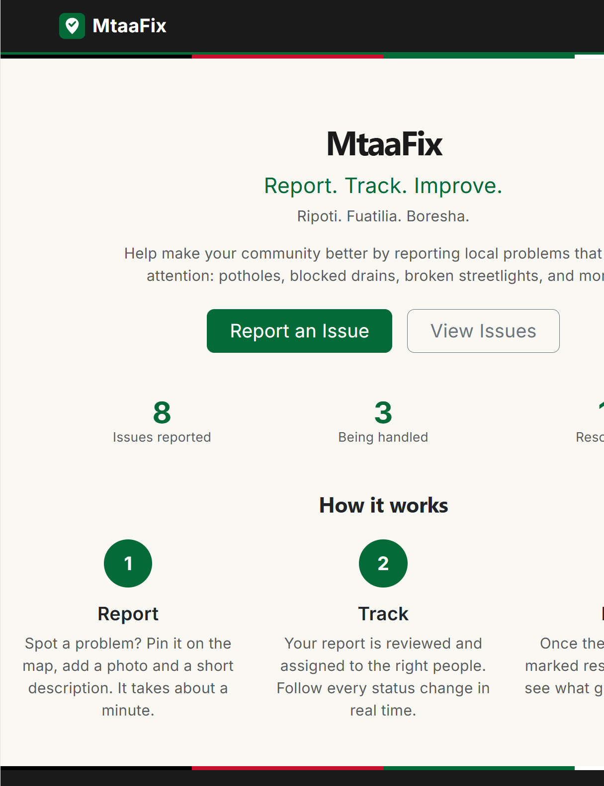
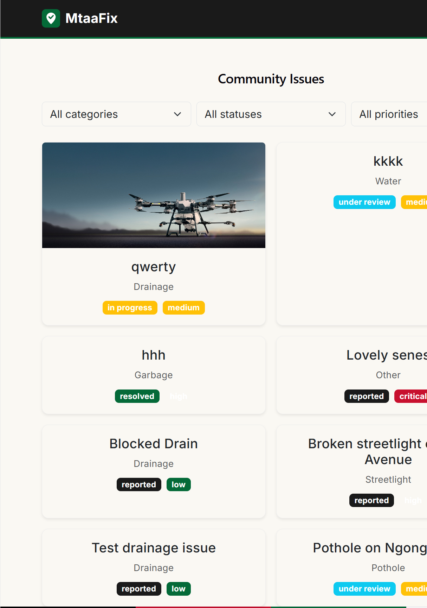
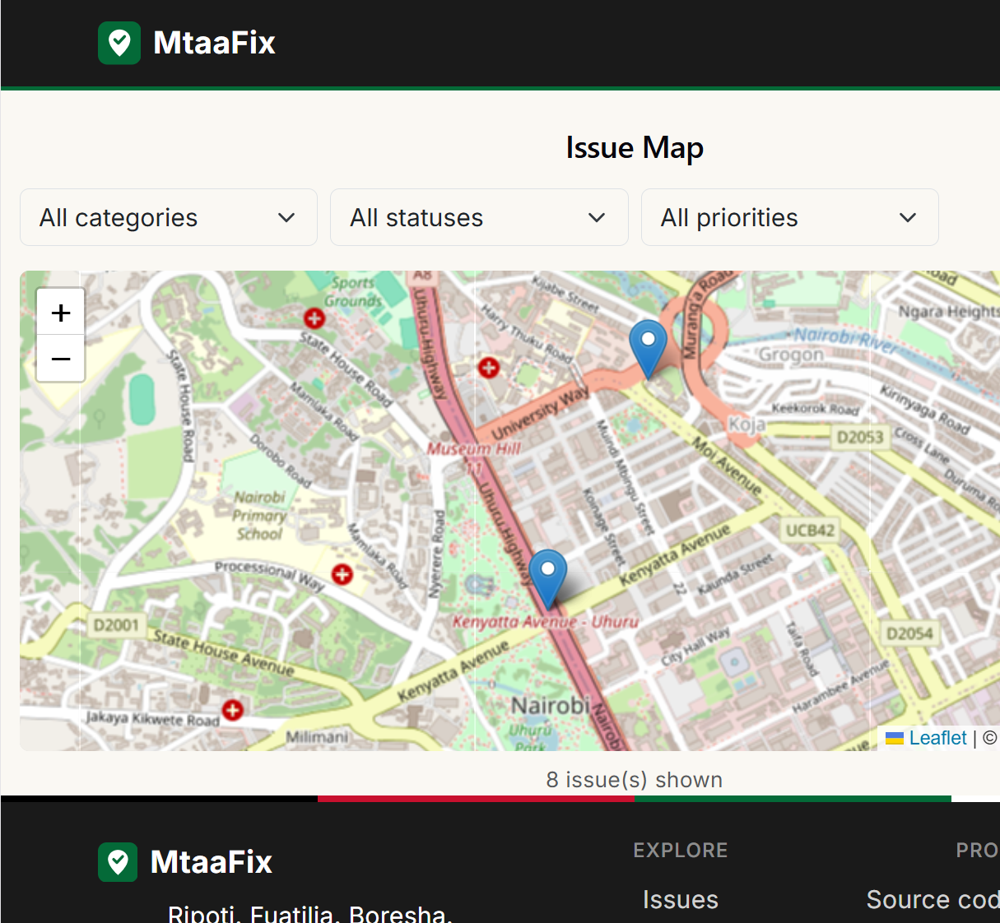
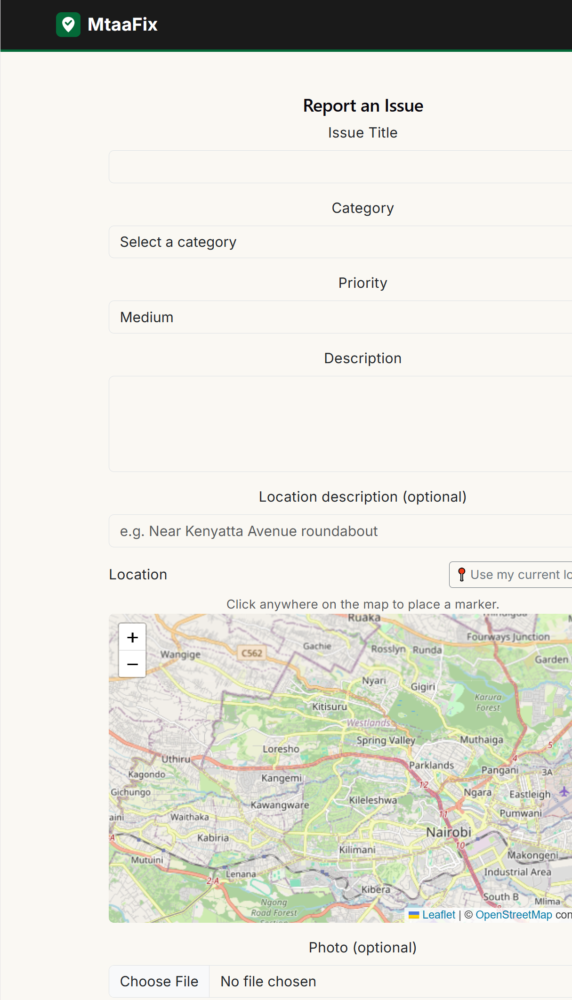
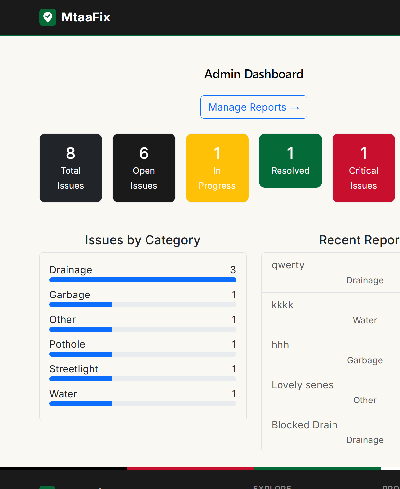
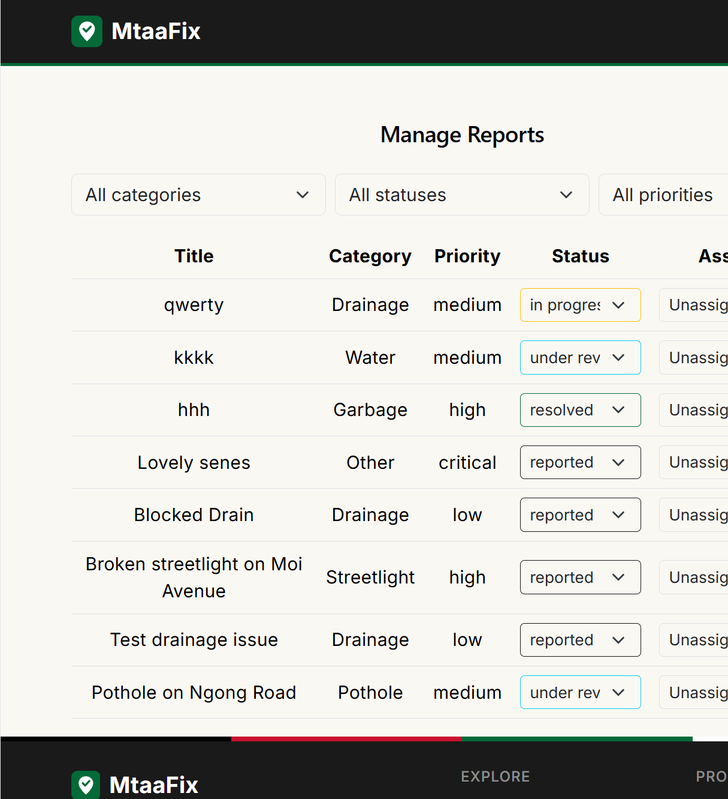
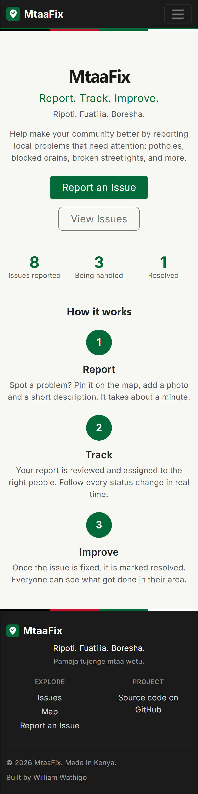
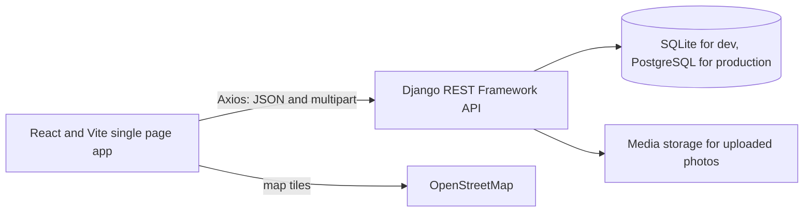
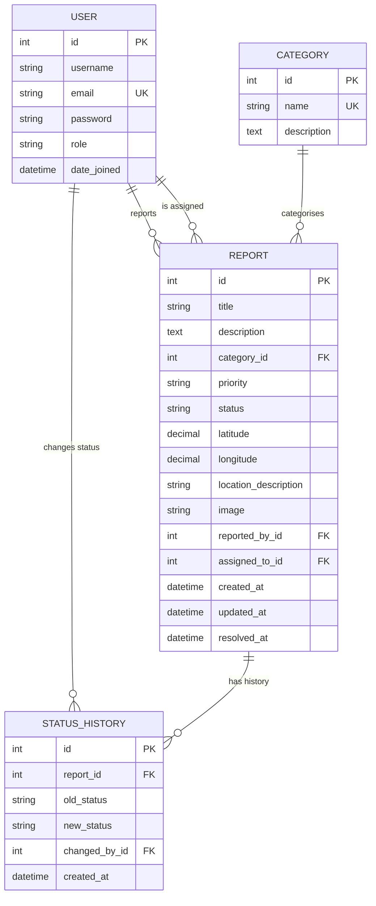

# MtaaFix

**Report. Track. Improve.** · *Ripoti. Fuatilia. Boresha.*

MtaaFix is a web platform where Kenyan communities report local public problems (potholes, blocked drains, uncollected garbage, broken streetlights, water leaks) and follow what happens next. Residents file a report with a photo and a pin on the map. Administrators review, assign and resolve it. Every status change is recorded and visible, so nobody is left wondering whether their report was seen.

**Status:** MVP complete and running locally. Deployment is the next step. Live demo: *coming soon*.

---

## Problem

Public infrastructure problems are easy to spot and hard to report. Residents often don't know who is responsible, have no record that a problem was raised, and never learn whether anything was done about it. Authorities and community organisations, in turn, often receive complaints scattered across calls, social media and word of mouth, with no shared view of what is open, who is handling it, and what has been fixed.

## Solution

MtaaFix gives both sides one shared, transparent record:

- Residents submit a report in about a minute: category, description, photo and an exact location on the map.
- Administrators see every report in one place, filter it, assign it and move it through a clear lifecycle.
- Anyone can browse the public issue list and map, and the person who reported an issue can follow its progress step by step.

### Issue lifecycle

```text
Reported -> Under Review -> Assigned -> In Progress -> Resolved

Rejected: can be set by an administrator when a report is invalid or out of scope
```

Each transition is stored with a timestamp and the staff member who made it.

---

## Features

**Residents**

- Register, log in and log out
- Report an issue with title, category, priority, description, photo (JPEG, PNG or WebP, up to 5 MB) and location
- Pick the location by clicking the map, or use browser geolocation (only after the browser's own permission prompt)
- See your own submissions under **My Reports**
- Follow each report on a step-by-step progress timeline with dates
- Browse and filter all public issues by category, status and priority
- Explore issues on an interactive map with details in each marker's popup

**Administrators**

- Dashboard with total, open, in-progress, resolved and critical counts, issues by category, and recent reports
- **Manage Reports** table with filters, status changes and assignment to staff
- Every status change is logged (who, when, from what to what); the resolved date is set automatically
- Role-based access: `resident`, `admin` and `officer` (officer permissions exist at the API level; a dedicated officer interface is planned)

**Design**

- Mobile-first layout with a collapsing navigation menu
- Restrained palette inspired by the Kenyan flag, accessible markup (`aria-current` on the active step, labelled controls)
- Swahili taglines, with full localisation planned

---

## Screenshots

| | |
|---|---|
|  |  |
|  |  |
|  |  |
|  |  |

---

## Technology stack

| Layer | Technology |
|---|---|
| Frontend | React, Vite, React Router, Axios, Bootstrap 5 |
| Maps | Leaflet, React-Leaflet, OpenStreetMap tiles (no paid map service) |
| Backend | Python, Django, Django REST Framework |
| Authentication | DRF token authentication, with a structure that allows moving to JWT later |
| Database | SQLite for local development, PostgreSQL planned for production |
| Configuration | python-decouple (environment variables), django-cors-headers |
| Images | Pillow (via Django `ImageField`) |
| Testing | Django `TestCase` and DRF `APITestCase` |

---

## Architecture



The frontend and backend are separate projects that communicate only through the REST API, so each can be deployed independently.

### Project structure

```text
mtaafix/
├── backend/
│   ├── config/            Django settings and root URLs
│   ├── users/             Custom User model (with roles), register, login, user list
│   ├── reports/           Report, Category, StatusHistory, API, dashboard statistics, tests
│   ├── notifications/     Scaffolded for in-app notifications (not built yet)
│   ├── manage.py
│   └── requirements.txt
├── frontend/
│   └── src/
│       ├── components/    Navbar, Footer, Logo, LocationPicker, ProtectedRoute
│       ├── context/       AuthContext (current user and role)
│       ├── pages/         Home, Login, Register, IssueList, IssueDetail, IssueMap,
│       │                  ReportIssue, MyReports, AdminDashboard, AdminReports
│       └── services/      Axios client and API helper modules
├── docs/screenshots/      Images used in this README
├── .env.example
└── README.md
```

### Design decisions

- **Custom user model with a `role` field from the start.** Changing the user model after the first migration is painful, so roles are part of the model instead of a bolt-on profile table.
- **Categories are a table, not a hard-coded list.** New categories can be added from the admin without a code change or migration.
- **Two report serializers.** The list endpoint returns a lightweight shape for fast lists and maps. The detail endpoint adds the description and the status history.
- **Status changes and assignment go through dedicated endpoints.** The generic update endpoint ignores `status` and `assigned_to`. A report's status can only change via `status_change`, which writes the history row and the `resolved_at` timestamp in the same request. Assignment goes through `assign`, which is staff-only and only accepts admin or officer accounts as the assignee.
- **The server decides who the reporter is.** `reported_by` is taken from the authenticated user, never from the request body.
- **Aggregations run in the database.** Dashboard counts use `values().annotate(Count())` instead of loading rows into Python.

---

## Getting started

### Prerequisites

- Python 3.12 or newer
- Node.js (current LTS) and npm
- Git

### 1. Clone

```bash
git clone https://github.com/william-wathigo-karanja/mtaafix.git
cd mtaafix
```

### 2. Backend

Windows (PowerShell):

```powershell
cd backend
python -m venv venv
venv\Scripts\Activate.ps1
pip install -r requirements.txt
```

macOS / Linux:

```bash
cd backend
python3 -m venv venv
source venv/bin/activate
pip install -r requirements.txt
```

Create your environment file. Copy `.env.example` (in the project root) to `.env` in the same place, then generate a secret key and paste it in as `SECRET_KEY`:

```bash
python -c "from django.core.management.utils import get_random_secret_key; print(get_random_secret_key())"
```

Then create the database and an administrator account, and start the server:

```bash
python manage.py migrate
python manage.py createsuperuser
python manage.py runserver
```

The API is now at `http://127.0.0.1:8000/api/`.

**Two one-time setup steps in the Django admin** (`http://127.0.0.1:8000/admin/`):

1. **Make your account an administrator in the app.** Open *Users*, select your account and set **Role** to *Admin*. The custom user model gives every new account, including superusers, the Resident role by default.
2. **Add the categories.** Open *Categories* and add the ones you need, for example: Pothole, Drainage, Garbage, Streetlight, Water, Flooding, Road Damage, Public Infrastructure, Other. The report form's category list stays empty until you do.

### 3. Frontend

In a second terminal:

```bash
cd frontend
npm install
npm run dev
```

Open `http://localhost:5173`.

---

## Environment variables

Configuration is read from a `.env` file in the project root. The file is git-ignored; `.env.example` is the template.

| Variable | Required | Description |
|---|---|---|
| `SECRET_KEY` | Yes | Django secret key. Generate a unique one per environment. |
| `DEBUG` | No (default `False`) | Set to `True` for local development only. |
| `ALLOWED_HOSTS` | Yes in production | Comma-separated hostnames, for example `localhost,127.0.0.1`. |
| `DATABASE_URL` | Not used yet | Listed in `.env.example` for the PostgreSQL setup that arrives with deployment. |

Never commit a real `.env` file.

---

## API documentation

Base URL (local): `http://127.0.0.1:8000/api`

Protected endpoints expect the token returned at login:

```text
Authorization: Token <your-token>
```

Requests with no token to a protected endpoint return `401`. Requests from a signed-in user who lacks permission return `403`.

### Authentication

| Method | Endpoint | Access | Description |
|---|---|---|---|
| POST | `/auth/register/` | Public | Create a resident account. Body: `username`, `email`, `password` (min 8 characters). Returns the user and a token. The role cannot be set by the client. |
| POST | `/auth/login/` | Public | Body: `username`, `password`. Returns `token` and `user`. |
| POST | `/auth/logout/` | Signed in | Deletes the caller's token. |
| GET | `/auth/me/` | Signed in | Returns the current user. |
| GET | `/users/` | Admin | Lists all users. |

### Categories

| Method | Endpoint | Access | Description |
|---|---|---|---|
| GET | `/categories/` | Public | List categories. |
| POST, PUT, PATCH, DELETE | `/categories/` and `/categories/{id}/` | Admin | Manage categories. |

### Reports

| Method | Endpoint | Access | Description |
|---|---|---|---|
| GET | `/reports/` | Public | List reports (lightweight shape, including the `assigned_to` id). Filters: `category` (id), `status`, `priority`, and `reported_by=me` (needs a token). |
| POST | `/reports/` | Signed in | Create a report as `multipart/form-data`: `title`, `description`, `category`, `priority`, `latitude`, `longitude`, optional `location_description` and `image`. Status always starts as `reported`. |
| GET | `/reports/{id}/` | Public | Full report including `status_history`. |
| PATCH, PUT, DELETE | `/reports/{id}/` | Owner, admin or officer | Edit or delete a report. `status`, `assigned_to`, `reported_by` and timestamps are read-only here. |
| PATCH | `/reports/{id}/status_change/` | Admin or officer | Body: `{"status": "under_review"}`. Validates the value, writes a `StatusHistory` row and sets `resolved_at` when resolved. |
| PATCH | `/reports/{id}/assign/` | Admin or officer | Body: `{"assigned_to": <staff user id or null>}`. Only admin or officer accounts can be assigned; `null` unassigns. |

Valid statuses: `reported`, `under_review`, `assigned`, `in_progress`, `resolved`, `rejected`.
Valid priorities: `low`, `medium`, `high`, `critical`.

### Dashboard

| Method | Endpoint | Access | Description |
|---|---|---|---|
| GET | `/dashboard/statistics/` | Admin or officer | Totals, counts by status, issues by category, critical count and the five most recent reports. |

### Example requests

```bash
# Register
curl -X POST http://127.0.0.1:8000/api/auth/register/ \
  -H "Content-Type: application/json" \
  -d '{"username":"jane","email":"jane@example.com","password":"a-strong-password"}'

# Submit a report with a photo
curl -X POST http://127.0.0.1:8000/api/reports/ \
  -H "Authorization: Token <your-token>" \
  -F "title=Blocked drain on Moi Avenue" \
  -F "description=Water pools on the road after rain" \
  -F "category=2" -F "priority=high" \
  -F "latitude=-1.286389" -F "longitude=36.817223" \
  -F "image=@drain.jpg"

# Change a report's status (admin)
curl -X PATCH http://127.0.0.1:8000/api/reports/1/status_change/ \
  -H "Authorization: Token <admin-token>" \
  -H "Content-Type: application/json" \
  -d '{"status":"under_review"}'
```

---

## Database structure



**Relationships and delete behaviour**

- A report belongs to one category and one reporter. Both use `PROTECT`, so a category or user that still has reports cannot be deleted by accident.
- `assigned_to` is optional and uses `SET_NULL`: removing a staff account simply returns its reports to unassigned.
- Status history rows are removed with their report (`CASCADE`). `changed_by` uses `SET_NULL` so the audit trail survives if an account is removed.
- Indexes on `Report.status`, `Report.category` and `Report.created_at` support the main filters and sort order. `User.email` is unique.

---

## Testing

```bash
cd backend
python manage.py test
```

There are 32 automated tests. They run against a separate test database and never touch your development data. They cover:

- Model defaults, string representations and uniqueness constraints
- Anonymous, signed-in and owner access rules on reports
- Residents being unable to change their own report's status
- The `status_change` endpoint: admin success with a history row, resident rejected, invalid status rejected
- Report assignment: staff only, valid staff assignees only, and the generic update endpoint still ignoring `assigned_to`
- Category management restricted to administrators
- Category filtering
- Dashboard access control (admin allowed, resident rejected)

The permission tests have already paid for themselves. While writing them, one caught a real bug where an anonymous request could reach the create endpoint and crash it instead of being rejected. Later, documenting the API exposed two more gaps: report assignment silently failed to save, and any signed-in user could edit categories. Both are fixed and now covered by tests.

---

## Security

- Passwords are hashed by Django; plain-text passwords are never stored or returned
- Token authentication, with roles enforced on the server through DRF permission classes (hiding a button in the UI is never relied on)
- Fields that must not be client-controlled (`reported_by`, `status`, `assigned_to`, timestamps) are read-only on the generic update endpoint
- Secrets live in environment variables, and `.env` is git-ignored
- CORS is limited to the configured frontend origin
- Uploaded files must be valid images (Django `ImageField` plus Pillow), with type and size checked in the browser before upload
- Django's CSRF middleware remains enabled

---

## Deployment

Planned setup:

| Part | Platform |
|---|---|
| Frontend | Vercel |
| Backend | Render, Railway or Fly.io (to be decided) |
| Database | Managed PostgreSQL |

Before going live, these local-only settings need to become environment-driven: the API base URL in the frontend (currently hard-coded to the local server), the allowed CORS origins, `DEBUG`, `ALLOWED_HOSTS` and the database connection. Uploaded photos are currently stored on local disk, so a host with an ephemeral filesystem will need object storage or a persistent volume.

---

## Known limitations and future improvements

Known limitations:

- Tokens do not expire and are kept in the browser's `localStorage`; expiring tokens or JWT with httpOnly cookies would be safer
- Image size is enforced in the browser only; a server-side size limit should be added
- Report lists are not paginated, and the homepage counters are calculated in the browser
- The reporter's username is shown on public issue pages (an anonymous-reporting option would improve privacy)
- Categories must be added manually after setup (a seed command is a good first contribution)
- The officer role has API permissions but no dedicated interface

Planned:

- In-app notifications (the `notifications` app is scaffolded), then email and SMS
- User management screen for administrators
- Full Swahili language support
- County and ward level dashboards, and support for multiple organisations
- Duplicate-issue detection and AI-assisted categorisation
- Offline reporting and a mobile app
- Open-data dashboard and a public API

---

## License

Released under the MIT License. See [LICENSE](LICENSE).

## Author

**William Wathigo Karanja**
GitHub: [@william-wathigo-karanja](https://github.com/william-wathigo-karanja)